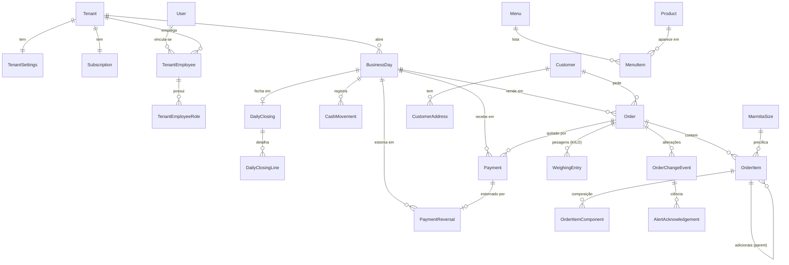

# 04. Modelo de Dados (conceitual)

> Consolida o §6 do épico com os ADRs 0001–0039. É o modelo **conceitual**: entidades, campos, relacionamentos, invariantes e cálculos derivados. O modelo **físico** (DDL, tipos PostgreSQL, índices, RLS, papéis) virá em `05-ddl.md` e deve seguir este documento. Se os dois divergirem, corrija os dois antes de implementar.

## 4.0 Convenções

| Item | Regra |
|---|---|
| Identificador | `Id` UUID v7 gerado na aplicação |
| Tenant | Toda entidade marcada **[T]** implementa `ITenantOwned`: tem `TenantId`, query filter do EF e RLS. FKs entre entidades [T] incluem `TenantId` (ADR-0026) |
| Instantes | `DateTimeOffset` em UTC (`...At`) |
| Data operacional | `DateOnly` (`BusinessDate`), na data local do tenant (ADR-0019) |
| Dinheiro | `Money` = `decimal` com 2 casas, BRL (ADR-0030) |
| Peso | `int` em gramas (ADR-0030) |
| Autor da ação | `...ByEmployeeId` → `TenantEmployee.Id`. O vínculo nunca é apagado, então a autoria sobrevive à desativação (RN-001.7) |
| Concorrência | **[V]** = agregado com `Version int`, incrementado em toda alteração do agregado, inclusive dos filhos (ADR-0034) |
| Sincronização | **[S]** = alterações geram entrada no `ChangeFeedEntry` (ADR-0032) |
| Exclusão | Entidades financeiras e históricas **nunca** são apagadas fisicamente. Usam `Status`/`RemovedAt`/`IsActive` |
| Enums | Valores `UPPER_SNAKE`, persistidos como texto |

Tipos usados nas tabelas: `Guid`, `string(n)`, `Money`, `int`, `bool`, `DateOnly`, `DateTimeOffset`, `enum`, `json`. `?` = opcional.

## 4.1 Mapa por módulo (ADR-0029)

| Módulo | Entidades |
|---|---|
| Identity | `User`, `Tenant`, `TenantSettings`, `TenantEmployee`, `TenantEmployeeRole`, `EmployeeInvitation`, `SharedDevice`, `RefreshToken` |
| Billing | `Subscription`, `TrialClaim`, `BillingWebhookEvent` |
| Catalog | `Product`, `MarmitaSize` |
| Menu | `Menu`, `MenuItem` |
| Ordering | `Customer`, `CustomerAddress`, `Order`, `OrderItem`, `OrderItemComponent`, `WeighingEntry`, `OrderChangeEvent`, `AlertAcknowledgement` |
| Payments | `Payment`, `PaymentReversal` |
| Closing | `BusinessDay`, `BusinessDateCounter`, `CashMovement`, `DailyClosing`, `DailyClosingLine`, `ClosingAdjustment` |
| Audit | `AuditLog` |
| Sync | `TenantSyncCounter`, `ChangeFeedEntry`, `IdempotencyRecord`, `OutboxMessage` |

**Diferenças em relação ao §6.1 do épico:**
- `Role` e `Permission` **não são tabelas**. São constantes em código (ADR-0028), e o vínculo é `TenantEmployeeRole`.
- `DailyClosing` passa a pertencer a um `BusinessDay` (ADR-0019).

## 4.2 Diagrama (núcleo operacional)

---

## 4.3 Identity

### User (global, sem tenant)

Identidade autenticada (ASP.NET Core Identity, ADR-0027).

| Campo | Tipo | Regra |
|---|---|---|
| Id | Guid | |
| FullName | string(120) | |
| Email | string(254)? | único (case-insensitive) quando presente; obrigatório para quem é proprietário |
| PhoneNumber | string(16)? | E.164, único quando presente |
| PasswordHash, SecurityStamp, LockoutEnd, AccessFailedCount | Identity | |
| IsPlatformAdmin | bool | `true` só por script de plataforma (ADR-0025) |
| CreatedAt | DateTimeOffset | |

**Invariante:** `Email` ou `PhoneNumber` precisa estar presente.

### Tenant (é o próprio tenant)

| Campo | Tipo | Regra |
|---|---|---|
| Id | Guid | = `TenantId` |
| Name | string(120) | nome fantasia |
| DocumentType | enum `CPF`, `CNPJ` | |
| DocumentNumber | string(14) | só dígitos |
| City, State | string(80), string(2) | |
| TimeZone | string(64) | IANA, padrão `America/Sao_Paulo` |
| TermsVersion, TermsAcceptedAt, TermsAcceptedByUserId | string(20), DateTimeOffset, Guid | aceite dos Termos e do contrato de tratamento no autocadastro (ADR-0018, ADR-0024) |
| CreatedAt | DateTimeOffset | |
| Version | int | [V] |

### TenantSettings [T][V][S] — 1:1 com Tenant

| Campo | Tipo | Regra |
|---|---|---|
| TenantId | Guid | PK |
| KiloPricePerKg | Money? | obrigatório para registrar pesagem (ADR-0020) |
| DefaultDeliveryFee | Money | ≥ 0, padrão 0 (ADR-0021) |
| EnabledPaymentMethods | enum[] | subconjunto de `CASH`, `PIX`, `CARD`; pelo menos 1 |
| SharedDeviceIdleSeconds | int | padrão 120 (ADR-0027) |

### TenantEmployee [T][V][S] — vínculo usuário ↔ estabelecimento

| Campo | Tipo | Regra |
|---|---|---|
| Id | Guid | é o "funcionário" referenciado em toda autoria |
| UserId | Guid | → User. Único por `(TenantId, UserId)` |
| DisplayName | string(60) | nome exibido no estabelecimento e na seleção do dispositivo compartilhado |
| Status | enum `ACTIVE`, `INACTIVE` | |
| PinHash | string? | PIN de 4–6 dígitos, só para dispositivos compartilhados (ADR-0027) |
| PinFailedAttempts, PinLockedUntil | int, DateTimeOffset? | 5 tentativas → bloqueio de 15 min |
| SecurityStamp | Guid | muda ao desativar ou mudar perfis, o que revoga o acesso (ADR-0027) |
| JoinedAt | DateTimeOffset | |
| DeactivatedAt, DeactivatedByEmployeeId | DateTimeOffset?, Guid? | |

**Invariante:** um tenant precisa ter pelo menos um funcionário `ACTIVE` com o perfil `OWNER`.

### TenantEmployeeRole [T]

| Campo | Tipo | Regra |
|---|---|---|
| TenantEmployeeId | Guid | PK composta |
| Role | enum `OWNER`, `MANAGER`, `ATTENDANT`, `KITCHEN`, `CASHIER` | PK composta |

As permissões efetivas são a união dos mapas perfil → permissões definidos em código (ADR-0028).

### EmployeeInvitation [T]

| Campo | Tipo | Regra |
|---|---|---|
| Purpose | enum `INVITE`, `PASSWORD_RESET` | o reset reaproveita o mecanismo do convite (ADR-0018) |
| Code | string(6) | alfanumérico sem caracteres ambíguos; único entre convites `PENDING` |
| Roles | enum[] | obrigatório para `INVITE` |
| TargetEmployeeId | Guid? | obrigatório para `PASSWORD_RESET` |
| Status | enum `PENDING`, `ACCEPTED`, `REVOKED`, `EXPIRED` | |
| ExpiresAt | DateTimeOffset | criação + 72 h |
| CreatedByEmployeeId, CreatedAt | | |
| AcceptedByUserId, AcceptedAt | Guid?, DateTimeOffset? | |

### SharedDevice [T]

Aparelho registrado como compartilhado (ADR-0027).

| Campo | Tipo | Regra |
|---|---|---|
| InstallationId | string(64) | id da instalação do app, gerado pelo cliente; único por tenant |
| Name | string(40) | ex.: "Tablet cozinha" |
| Platform | enum `ANDROID`, `IOS` | |
| SecretHash | string(64) | SHA-256 do `deviceSecret` entregue uma única vez no registro. O aparelho se autentica com ele para listar funcionários e fazer o login por PIN (`06-contratos-api.md` §6.3) |
| RegisteredByEmployeeId, RegisteredAt | | |
| RevokedAt | DateTimeOffset? | |

### RefreshToken (identidade, sem RLS de tenant)

| Campo | Tipo | Regra |
|---|---|---|
| UserId | Guid | |
| TenantId, TenantEmployeeId | Guid | tenant ativo da sessão |
| InstallationId | string(64) | |
| SharedDeviceId | Guid? | quando emitido via PIN |
| TokenHash | string | SHA-256; o token em si nunca é gravado |
| FamilyId | Guid | reuso de token já trocado → revoga a família inteira |
| CreatedAt, ExpiresAt, RevokedAt | | 30 dias |
| ReplacedByTokenId | Guid? | |

---

## 4.4 Billing (ADR-0017)

### Subscription [T][V] — 1:1 com Tenant

| Campo | Tipo | Regra |
|---|---|---|
| Status | enum `TRIALING`, `ACTIVE`, `PAST_DUE`, `SUSPENDED`, `CANCELED` | **só muda por webhook, job ou admin** |
| PlanCode | string(30) | |
| MonthlyPrice | Money | snapshot do preço contratado |
| TrialEndsAt | DateTimeOffset | criação + 7 dias |
| CurrentPeriodEndsAt | DateTimeOffset? | |
| PastDueSince, SuspendedAt, CanceledAt | DateTimeOffset? | |
| GatewayCustomerId, GatewaySubscriptionId | string? | Asaas |

### TrialClaim (plataforma)

`ClaimKey` (único) = **SHA-256** do documento normalizado ou do telefone do proprietário (o valor em claro não é guardado, ADR-0024), mais `TenantId` e `ClaimedAt`. Garante um teste grátis por documento ou telefone.

### BillingWebhookEvent (plataforma)

| Campo | Tipo | Regra |
|---|---|---|
| Gateway | string(20) | `ASAAS` |
| GatewayEventId | string(100) | **único**: processamento idempotente |
| EventType | string(60) | |
| TenantId | Guid? | resolvido pelo `GatewaySubscriptionId` |
| Payload | json | só os campos usados; sem dados de cartão |
| ReceivedAt, ProcessedAt | | |

---

## 4.5 Catalog (ADR-0020)

### Product [T][V][S]

| Campo | Tipo | Regra |
|---|---|---|
| Kind | enum `MAIN_DISH`, `SIDE_DISH`, `BEVERAGE`, `ADDON` | imutável após uso em pedido |
| Name | string(80) | único por `(TenantId, Kind)` entre ativos |
| Description | string(300)? | |
| Category | string(40)? | agrupamento livre para exibição ("Refrigerantes", "Carnes") |
| DefaultPrice | Money? | **obrigatório** para `BEVERAGE`/`ADDON`; para `MAIN_DISH` é o preço padrão de PF; nulo para `SIDE_DISH` |
| RequiresPreparation | bool | padrão: `true` para pratos e adicionais, `false` para bebidas. Decide se a inclusão gera produção ou alerta (RN-007.10) |
| ImageStorageKey | string? | chave no R2 (ADR-0037); a URL é derivada |
| IsActive | bool | desativado = some dos cadastros, mas o histórico permanece (RN-002.6) |
| IsAvailable | bool | falta momentânea de bebida ou adicional (pratos usam a disponibilidade do cardápio) |
| CreatedAt, UpdatedAt | | |

### MarmitaSize [T][V][S]

`Name` string(20), `Price` Money > 0, `SortOrder` int, `IsActive` bool. Único por `(TenantId, Name)` entre ativos.

---

## 4.6 Menu (RF-003, ADR-0038)

### Menu [T][V][S]

| Campo | Tipo | Regra |
|---|---|---|
| MenuType | enum `MARMITA`, `PF` | cardápios independentes (RN-003.1) |
| Kind | enum `DAILY`, `WEEKLY_TEMPLATE` | |
| Date | DateOnly? | obrigatório para `DAILY`; único por `(TenantId, MenuType, Date)` |
| DayOfWeek | int? (1–7, ISO) | obrigatório para `WEEKLY_TEMPLATE`; único por `(TenantId, MenuType, DayOfWeek)` |
| SourceMenuId | Guid? | origem do clone ou da materialização (RN-003.4/3.5); só informativo |
| CreatedByEmployeeId, CreatedAt, UpdatedAt | | |

**Resolução do cardápio do dia** (ADR-0038):
- O cardápio vigente é o `DAILY` da `BusinessDate` do expediente aberto.
- Ao abrir o expediente, cada `WEEKLY_TEMPLATE` do dia da semana sem `DAILY` correspondente é **materializado** como um `DAILY` independente.
- Sem nenhum dos dois, a aba oferece criar o cardápio (RN-003.2).

### MenuItem [T]

| Campo | Tipo | Regra |
|---|---|---|
| MenuId, ProductId | Guid | único por `(MenuId, ProductId)` |
| Section | enum `MAIN_DISH`, `SIDE_DISH` | = `Product.Kind`; bebidas e adicionais não entram em cardápio |
| PfPrice | Money? | só em menu `PF` + `MAIN_DISH`; obrigatório nesse caso; padrão = `Product.DefaultPrice` |
| IsAvailable | bool | RN-003.6 |
| SortOrder | int | |

---

## 4.7 Ordering

### Customer [T][V][S] (ADR-0021, ADR-0024)

| Campo | Tipo | Regra |
|---|---|---|
| Name | string(80) | |
| PhoneNumber | string(16)? | E.164; único por tenant quando presente |
| Notes | string(300)? | |
| AnonymizedAt | DateTimeOffset? | após anonimizar: nome "Cliente anonimizado", telefone, endereços e notas apagados |
| CreatedAt | | |

### CustomerAddress [T]

`CustomerId`, `Label` string(30)?, `Street` string(120), `Number` string(10)?, `Complement` string(60)?, `Neighborhood` string(60)?, `Reference` string(120)?, `IsDefault` bool.

### Order [T][V][S] — agregado raiz (ADR-0005)

| Campo | Tipo | Regra |
|---|---|---|
| BusinessDayId | Guid | expediente aberto na criação (ADR-0019); imutável |
| BusinessDate | DateOnly | cópia de `BusinessDay.BusinessDate` = data da venda (ADR-0015) |
| OrderNumber | int | sequencial por **data operacional** (ADR-0023, ADR-0039) |
| OrderType | enum `MARMITA`, `PF`, `KILO` | imutável |
| Origin | enum `APP` (futuro: `WHATSAPP`) | |
| FulfillmentType | enum `DELIVERY`, `PICKUP`, `DINE_IN` | `MARMITA` → `DELIVERY`/`PICKUP`; `PF`/`KILO` → `DINE_IN` |
| CustomerId | Guid? | → Customer |
| CustomerName | string(80)? | snapshot; obrigatório em `MARMITA` |
| CustomerPhone | string(16)? | snapshot |
| DeliveryAddress | json? | snapshot do endereço; obrigatório se `DELIVERY` |
| TableLabel | string(10)? | mesa (PF/KILO) |
| TabNumber | string(10)? | número da comanda física (ADR-0023) |
| Notes | string(300)? | |
| DeliveryFee | Money | 0 se não for `DELIVERY` |
| ItemsTotal | Money | Σ `OrderItem.LineTotal` ativos |
| WeighingsTotal | Money | Σ `WeighingEntry.Amount` ativas |
| TotalAmount | Money | `ItemsTotal + WeighingsTotal + DeliveryFee` |
| PaidAmount | Money | Σ `Payment.Amount` com `Status = CONFIRMED` |
| IsPaid | bool | `TotalAmount > 0 && PaidAmount == TotalAmount` (RN-009.3) |
| ProductionStatus | enum `OPEN`, `IN_PROGRESS`, `COMPLETED`? | **nulo** para `KILO` (RN-006.7) |
| ProductionStatusChangedAt | DateTimeOffset? | |
| CancellationStatus | enum `ACTIVE`, `CANCELED` | ADR-0022 |
| CanceledAt, CanceledByEmployeeId, CancellationReason | ?, ?, string(300)? | |
| CreatedByEmployeeId, CreatedAt, UpdatedAt | | |

`ItemsTotal`, `WeighingsTotal`, `TotalAmount`, `PaidAmount` e `IsPaid` são **valores derivados e persistidos**. São recalculados pelo agregado na mesma transação de qualquer mudança em itens, pesagens, taxa ou pagamentos, e nunca recebidos do cliente.

**Invariantes do agregado:**
1. É preciso ter pelo menos 1 item ativo ou 1 pesagem ativa (na criação e após remoções).
2. `IsPaid` → itens, pesagens, quantidades e `DeliveryFee` imutáveis (ADR-0007, `409 OrderAlreadyPaid`).
3. `PaidAmount ≤ TotalAmount` sempre. Uma edição que deixaria `TotalAmount < PaidAmount` é rejeitada (`422 TotalBelowPaidAmount`).
4. `CANCELED` → somente leitura. Só pode ser cancelado com `PaidAmount == 0` (ADR-0022).
5. Incluir item com `RequiresPreparation` em pedido `COMPLETED` → `ProductionStatus = IN_PROGRESS` (RN-007.10).
6. `WeighingEntry` só em `KILO`. Itens `MARMITA` só em pedido `MARMITA`, itens `PF` só em pedido `PF`. Bebidas e adicionais avulsos em qualquer modalidade (RN-002.5).
7. Taxa de entrega diferente da padrão exige `orders.delivery-fee.edit`.

### OrderItem [T] — filho de Order

| Campo | Tipo | Regra |
|---|---|---|
| OrderId | Guid | |
| ParentOrderItemId | Guid? | adicional vinculado a uma marmita ou PF; nulo = item de primeiro nível |
| ItemKind | enum `MARMITA`, `PF`, `BEVERAGE`, `ADDON` | |
| ProductId | Guid? | `PF` → prato; `BEVERAGE`/`ADDON` → produto; nulo em `MARMITA` |
| MarmitaSizeId | Guid? | obrigatório em `MARMITA` |
| Quantity | int | ≥ 1. Em adicional filho, é a quantidade **por unidade do pai** |
| UnitPrice | Money | snapshot: tamanho (MARMITA), `MenuItem.PfPrice` (PF) ou `Product.DefaultPrice` |
| LineTotal | Money | `UnitPrice × Quantity × (Parent?.Quantity ?? 1)` |
| NameSnapshot | string(80) | ex.: "Marmita M", "PF Frango grelhado", "Coca 350ml" |
| CompositionSnapshot | string(500)? | texto legível da composição para a cozinha |
| RequiresPreparation | bool | snapshot de `Product.RequiresPreparation` (MARMITA/PF = `true`) |
| Notes | string(200)? | |
| Status | enum `ACTIVE`, `REMOVED` | remoção é lógica; totais ignoram `REMOVED` |
| CreatedByEmployeeId, CreatedAt, RemovedByEmployeeId, RemovedAt | | |

**Regras:**
- Adicionais só podem ser filhos de `MARMITA`/`PF`. Filho de filho não existe.
- Remover o pai remove os filhos.
- `Quantity` é editável na própria linha enquanto o pedido não está pago, e a mudança gera `OrderChangeEvent` `QUANTITY_CHANGED`. Não é preciso remover a linha e incluir outra.

### OrderItemComponent [T] — composição de marmita

`OrderItemId`, `ProductId`, `Role` enum `MAIN_DISH`/`SIDE_DISH`, `NameSnapshot` string(80). Não tem preço (ADR-0020). Uma marmita precisa de pelo menos 1 `MAIN_DISH`.

### WeighingEntry [T] — filho de Order (KILO)

| Campo | Tipo | Regra |
|---|---|---|
| WeightGrams | int | 1–50.000 |
| PricePerKg | Money | snapshot de `TenantSettings.KiloPricePerKg` (RN-006.3) |
| Amount | Money | `round(WeightGrams × PricePerKg / 1000, 2, AwayFromZero)` (ADR-0030) |
| Status | enum `ACTIVE`, `REMOVED` | |
| CreatedByEmployeeId, CreatedAt, RemovedByEmployeeId, RemovedAt | | |

### OrderChangeEvent [T] (RF-008, ADR-0031)

| Campo | Tipo | Regra |
|---|---|---|
| OrderId | Guid | |
| OrderVersion | int | versão do pedido após a alteração |
| ChangeKind | enum `ITEM_ADDED`, `ITEM_REMOVED`, `QUANTITY_CHANGED`, `ITEM_NOTES_CHANGED`, `ORDER_NOTES_CHANGED`, `WEIGHING_ADDED`, `WEIGHING_REMOVED`, `FULFILLMENT_CHANGED`, `ORDER_CANCELED` | |
| AffectsProduction | bool | `true` se envolve item com `RequiresPreparation`, observação de item ou cancelamento de pedido com produção |
| Details | json | antes/depois: nomes, quantidades, observações; **sem dados de cliente** |
| ActorEmployeeId | Guid | |
| OccurredAt | DateTimeOffset | |

A criação do pedido **não** gera `OrderChangeEvent`. Gera o evento de tempo real `OrderCreated`.

### AlertAcknowledgement [T]

PK `(OrderChangeEventId, TenantEmployeeId)`, `AcknowledgedAt`.

**Alerta pendente** para o funcionário F = `OrderChangeEvent` E tal que:
- `E.ActorEmployeeId ≠ F` (RN-008.6);
- F pode ver aquele pedido (permissão de produção para eventos com `AffectsProduction`; de pedidos para os demais);
- não existe `AlertAcknowledgement (E, F)` (RN-008.7);
- o pedido pertence a um expediente ainda `OPEN`.

---

## 4.8 Payments (ADR-0021, ADR-0022)

### Payment [T][S]

| Campo | Tipo | Regra |
|---|---|---|
| OrderId | Guid | |
| BusinessDayId, BusinessDate | Guid, DateOnly | expediente aberto no recebimento (ADR-0015) |
| Amount | Money | > 0 e ≤ saldo do pedido no momento |
| PaymentMethod | enum `CASH`, `PIX`, `CARD` | precisa estar em `EnabledPaymentMethods` |
| CashReceived | Money? | só `CASH`; ≥ `Amount` |
| ChangeGiven | Money? | `CashReceived − Amount` |
| Label | string(30)? | ex.: "Pessoa 2" (divisão de conta) |
| Status | enum `CONFIRMED`, `REVERSED` | |
| PaidAt | DateTimeOffset | |
| CreatedByEmployeeId | Guid | |

Um pagamento é imutável, exceto a transição `CONFIRMED → REVERSED`. Sempre estorna o valor integral.

### PaymentReversal [T][S]

| Campo | Tipo | Regra |
|---|---|---|
| PaymentId | Guid | **único** (um estorno por pagamento) |
| OrderId | Guid | |
| BusinessDayId, BusinessDate | Guid, DateOnly | expediente aberto **no estorno** (ADR-0014) |
| Amount | Money | = `Payment.Amount` |
| PaymentMethod | enum | = `Payment.PaymentMethod`; estorno `CASH` sai do dinheiro esperado |
| Reason | string(300) | mínimo 5 caracteres |
| CreatedByEmployeeId, CreatedAt | | |

---

## 4.9 Closing (ADR-0013, ADR-0019, ADR-0039)

### BusinessDay [T][V][S] — expediente

| Campo | Tipo | Regra |
|---|---|---|
| BusinessDate | DateOnly | data local na abertura; **não** é única (ADR-0039) |
| Status | enum `OPEN`, `CLOSED` | no máximo 1 `OPEN` por tenant |
| OpeningBalance | Money | ≥ 0 |
| OpenedByEmployeeId, OpenedAt | | |
| ClosedByEmployeeId, ClosedAt | ? | |

### BusinessDateCounter [T]

PK `(TenantId, BusinessDate)`, `LastOrderNumber int`. Fonte do `OrderNumber` (`UPDATE ... RETURNING`). Vários expedientes da mesma data continuam a mesma sequência (ADR-0039).

### CashMovement [T][S]

`BusinessDayId`, `MovementType` enum `SUPPLY`/`WITHDRAWAL`, `Amount` Money > 0, `Description` string(200), `CreatedByEmployeeId`, `CreatedAt`. Imutável. Uma correção é feita com outro movimento.

### DailyClosing [T][S] — snapshot imutável

| Campo | Tipo | Regra |
|---|---|---|
| BusinessDayId | Guid | **único** |
| BusinessDate | DateOnly | |
| OrderCount | int | pedidos `ACTIVE` do expediente |
| TotalSold | Money | Σ `TotalAmount` dos pedidos `ACTIVE` do expediente |
| DeliveryFeesTotal | Money | parte de `TotalSold` |
| TotalReceived | Money | Σ pagamentos recebidos neste expediente, de qualquer data de venda. Inclui os que foram estornados depois, porque o estorno é contado à parte em `ReversedTotal` do expediente em que ocorreu |
| ReceivedFromPreviousDays | Money | parte de `TotalReceived` relativa a pedidos de expedientes anteriores (RF-011) |
| TotalPending | Money | Σ `(TotalAmount − PaidAmount)` dos pedidos `ACTIVE` do expediente, no instante do fechamento |
| CanceledCount, CanceledTotal | int, Money | pedidos do expediente cancelados |
| ReversedCount, ReversedTotal | int, Money | estornos registrados neste expediente |
| OpeningBalance | Money | |
| CashReceived | Money | Σ `Amount` de pagamentos `CASH` recebidos aqui |
| CashReversed | Money | Σ estornos `CASH` registrados aqui |
| Supplies, Withdrawals | Money | |
| ExpectedCash | Money | `OpeningBalance + CashReceived + Supplies − Withdrawals − CashReversed` |
| CountedCash | Money | informado |
| CashDifference | Money | `CountedCash − ExpectedCash` |
| Justification | string(500)? | obrigatória se `CashDifference ≠ 0` (RN-010.13) |
| ClosedByEmployeeId, ClosedAt | | |

### DailyClosingLine [T] — detalhamento do snapshot

| Campo | Tipo | Regra |
|---|---|---|
| DailyClosingId | Guid | |
| Dimension | enum `ORDER_TYPE`, `PAYMENT_METHOD` | |
| Key | string | `MARMITA`/`PF`/`KILO` ou `CASH`/`PIX`/`CARD` |
| Sold, Received, Pending, Reversed | Money | `Sold`/`Pending` só em `ORDER_TYPE` |
| Count | int | pedidos (ORDER_TYPE) ou pagamentos (PAYMENT_METHOD) |

`ORDER_TYPE.Received` agrupa os pagamentos pelo `OrderType` do pedido pago. A tabela "Fechamento por modalidade" do épico é a projeção dessas linhas. O histórico mensal é a soma dos `DailyClosing` do mês.

### ClosingAdjustment [T][S]

| Campo | Tipo | Regra |
|---|---|---|
| RelatedClosingId | Guid | fechamento que está sendo corrigido |
| BusinessDayId | Guid | expediente aberto em que o ajuste foi registrado |
| AdjustmentType | enum `CASH_COUNT_CORRECTION`, `OTHER` | |
| Amount | Money (com sinal) | |
| Reason | string(500) | |
| CreatedByEmployeeId, CreatedAt | | permissão `closing.adjust` |

O ajuste **não** altera o `DailyClosing` relacionado nem o caixa físico. Aparece no histórico do fechamento original ("corrigido por") e no relatório do expediente em que foi registrado.

---

## 4.10 Audit (ADR-0008, ADR-0031)

### AuditLog — append-only

| Campo | Tipo | Regra |
|---|---|---|
| TenantId | Guid? | nulo só em ações de plataforma sem tenant |
| Origin | enum `APP`, `PLATFORM_ADMIN`, `SYSTEM`, `BILLING_WEBHOOK` | RN-013.4 |
| ActorUserId, ActorEmployeeId | Guid? | |
| SharedDeviceId | Guid? | |
| OperationType | string(60) | semântico: `OrderCreated`, `OrderItemAdded`, `PaymentRegistered`, `PaymentReversed`, `ClosingFinalized`, `EmployeeRolesChanged`… |
| EntityType, EntityId | string(40), Guid | |
| OrderId | Guid? | para `GET /orders/{id}/history` |
| Before, After | json? | só os campos relevantes; **sem telefone, endereço nem token** (ADR-0024) |
| CorrelationId | string(64) | `traceId` |
| OccurredAt | DateTimeOffset | |

---

## 4.11 Sync (ADR-0031–0033)

| Entidade | Campos | Regra |
|---|---|---|
| TenantSyncCounter | `TenantId` PK, `LastSeq` bigint | trava de linha por transação de escrita |
| ChangeFeedEntry [T] | PK `(TenantId, Seq)`, `EntityType`, `EntityId`, `EntityVersion`, `ChangeKind` (`UPSERT`/`DELETE`), `OccurredAt` | retenção de 7 dias |
| IdempotencyRecord [T] | `Key`, `UserId`, `Endpoint`, `RequestHash`, `Status` (`IN_PROGRESS`/`COMPLETED`), `ResponseStatus`, `ResponseBody` json, `ResourceId`, `CreatedAt`, `ExpiresAt` | único `(TenantId, Key)`; TTL de 72 h |
| OutboxMessage [T] | `EventType`, `Payload` json (ids, versão, `seq`), `OccurredAt`, `ProcessedAt?`, `Attempts` | limpeza após 7 dias |

**Entidades [S]:** `TenantSettings`, `TenantEmployee`, `Product`, `MarmitaSize`, `Menu` (inclui itens), `Customer` (inclui endereços), `Order` (inclui itens, pesagens e eventos), `Payment`, `PaymentReversal`, `BusinessDay`, `CashMovement`, `DailyClosing`, `ClosingAdjustment`.

---

## 4.12 Isolamento por tipo de tabela (ADR-0026)

| Tipo | Tabelas | Política |
|---|---|---|
| Tenant | todas as marcadas [T], mais `Tenant` (por `id`) e `Subscription` | `tenant_id = app.tenant_id` |
| Vínculo | `TenantEmployee`, `TenantEmployeeRole` | `tenant_id = app.tenant_id` **OU** `user_id = app.user_id`. Permite listar os estabelecimentos do próprio usuário no login e na troca de tenant (ADR-0026, item 9) |
| Identidade | `User`, `RefreshToken` | sem RLS de tenant; acesso só pelo módulo Identity |
| Plataforma | `TrialClaim`, `BillingWebhookEvent` | sem RLS; acesso só pelos módulos Billing e Admin com o papel `almoseis_platform` |

## 4.13 Mapeamento épico → modelo

| Épico (§6) | Aqui |
|---|---|
| `Order.TableNumber` | `TableLabel` + `TabNumber` |
| `Order.CustomerName/CustomerPhone` | `CustomerId` + snapshots |
| `Order.IsPaid` | derivado e persistido, com `PaidAmount` |
| `Payment.IdempotencyKey` | `IdempotencyRecord` (escopo de qualquer operação crítica) |
| `Payment.Status` | `CONFIRMED`/`REVERSED` + `PaymentReversal` |
| `DailyClosing.BusinessDate` | + `BusinessDayId` e o detalhamento em `DailyClosingLine` |
| `CashMovement.BusinessDate` | `BusinessDayId` (saldo inicial fica em `BusinessDay.OpeningBalance`) |
| `Role`, `Permission` | constantes em código + `TenantEmployeeRole` |
| `AuditLog` | + `Origin`, `OrderId`, `CorrelationId` |
